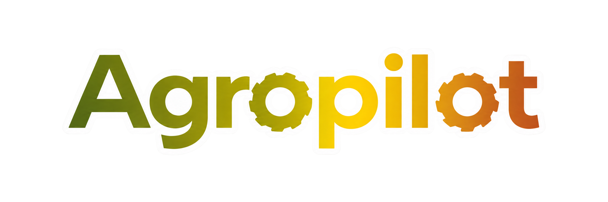

  

# Agropilot

Дипломен проект за автономен модел на трактор. Целта е тракторът да обработи участък от 2 × 2 m по успоредни ивици, да повдига плуга при завой и да спира при препятствие. При изпитанията ще измерим обработената площ и пропуснатите ивици.

Raspberry Pi 4 управлява двата задни мотора през платка Yahboom и получава данни от покривния LiDAR LDS02RR. Стъпков мотор 28BYJ-48 с драйвер ULN2003 върти осемте звезди на плуга, а серво SG90 повдига и спуска целия механизъм.

[Табло на проекта](https://github.com/users/PRPetkov22/projects/3) · [Задачи](https://github.com/PRPetkov22/Agropilot/issues) · [Етапи](https://github.com/PRPetkov22/Agropilot/milestones)
